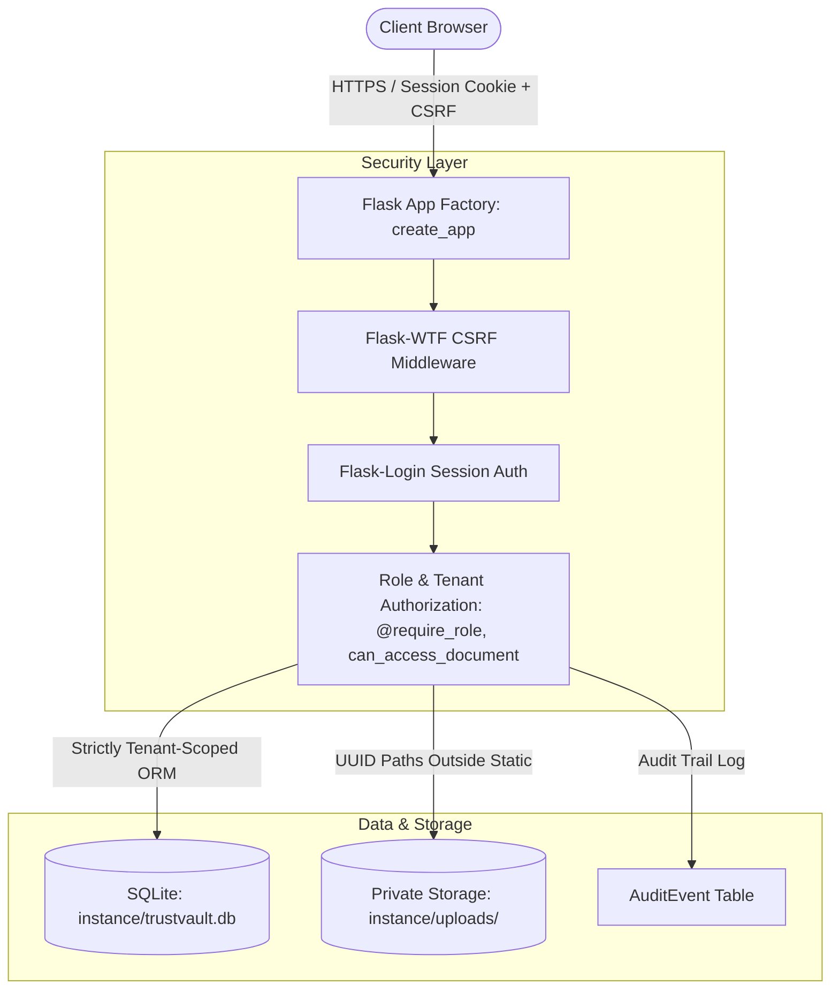

# TrustVault — Secure Sharing, Smarter Access, Verifiable Accountability

> **Snovasys Fresher Hiring Challenge 2026**  
> Candidate Project: Complete, secure, verifiable multi-tenant document vault built with Python, Flask, SQLAlchemy, and SQLite.

---

## 1. Project Overview & Real Features

TrustVault is an enterprise-grade document sharing web application designed with security-first principles. It provides:

* **Strict Multi-Tenancy:** Complete tenant isolation between companies. Every query and file download enforces tenant boundaries server-side; cross-organization access is strictly impossible even if document IDs are guessed.
* **Role-Based Access Control (RBAC):**
  * `ADMIN`: Manages organization members, reviews audit trails, and toggles user activation status.
  * `OWNER`: Uploads documents, manages sharing permissions, immediately revokes access, and deletes own documents.
  * `VIEWER`: Read-only access to documents explicitly shared with them. Cannot upload, share, revoke, or delete.
* **Private Storage Architecture:** Uploaded files are stored in `instance/uploads/` (strictly outside the static directory) under random UUID filenames. Direct web URL access is blocked. Downloads require authenticated session checks and permission validation via `send_from_directory`.
* **Immediate Revocation:** Revoking access instantly blocks subsequent downloads through the application. (As noted in system design, revocation cannot delete local copies already saved to a user's machine).
* **Multi-Layer Magic Byte & Polyglot Defense:** Validates binary headers (`%PDF`, `\x89PNG`, `\xff\xd8\xff`, `PK\x03\x04`) on all uploads and rejects disguised PE/ELF executables, shell scripts, web shells, and null-byte poison attacks.
* **Cryptographic SHA-256 Checksum Verification:** Calculates file hashes on upload and validates integrity before serving downloads, instantly catching offline disk tampering.
* **Account Lockout & Brute-Force Rate Limiting:** Locks accounts for 15 minutes after 5 consecutive failed login attempts, recording `ACCOUNT_LOCKED` security events.
* **OWASP Security Headers & Download Sandboxing:** Enforces `X-Frame-Options: DENY`, `X-Content-Type-Options: nosniff`, `Content-Security-Policy`, and download sandboxing (`sandbox; default-src 'none'`).
* **Verifiable Audit Logging:** Centralized recording of logins, logouts, uploads, downloads, shares, revocations, deletions, and access violations (`ACCESS_DENIED`).
* **Safe Admin Bootstrap:** Administrative roles cannot be registered through public forms. The initial admin is provisioned via the secure CLI command `flask bootstrap-admin` using environment secrets.
* **Dual Enterprise Design System:** Clean modern Light Theme (default) with an interactive switcher to Dark Emerald mode, featuring high contrast typography, frosted glassmorphism, and contextual watermark 3D graphics.

---

## 2. Architecture & Design



### Database Schema (Foreign Keys & Constraints)
* `tenants`: `id`, `name`, `slug` (unique, indexed), `created_at`
* `users`: `id`, `email` (unique, indexed), `password_hash`, `full_name`, `is_active_account`, `created_at`
* `tenant_memberships`: `id`, `user_id` (FK), `tenant_id` (FK), `role` (`ADMIN | OWNER | VIEWER`), `uq_user_tenant` constraint
* `documents`: `id`, `tenant_id` (FK), `owner_id` (FK), `original_filename`, `storage_filename` (unique UUID), `file_type`, `file_size_bytes`, `category`, `description`, `is_deleted`
* `access_permissions`: `id`, `document_id` (FK), `user_id` (FK), `granted_by_id` (FK), `uq_doc_user_permission` constraint
* `audit_events`: `id`, `tenant_id` (FK), `user_id` (FK), `action`, `resource_type`, `resource_id`, `ip_address`, `status`, `details`, `created_at`

---

## 3. Prerequisites

* **Python:** 3.12 or newer (Tested and verified on Python 3.14.6 64-bit)
* **Git:** Installed on local PATH
* **Virtual Environment:** Built-in `venv` module

---

## 4. Setup & Installation

### Step 1: Clone or Open Project
```powershell
cd "C:\Users\SRIRAMA NAGAPUNNARAO\OneDrive\Desktop\TrustVault"
```

### Step 2: Create & Activate Virtual Environment
```powershell
python -m venv .venv
.\.venv\Scripts\Activate.ps1
```

### Step 3: Install Pinned Dependencies
```powershell
pip install -r requirements.txt
```

### Step 4: Environment Variables Setup
Copy the `.env.example` file to `.env`:
```powershell
Copy-Item .env.example .env
```
Key configuration parameters inside `.env`:
```ini
FLASK_APP=run.py
FLASK_ENV=development
SECRET_KEY=change-this-to-a-very-secure-random-secret-key-in-production
DATABASE_URL=sqlite:///trustvault.db
UPLOAD_FOLDER=instance/uploads
MAX_CONTENT_LENGTH=10485760  # 10 MB

ADMIN_EMAIL=admin@trustvault.local
ADMIN_PASSWORD=ChangeMeImmediately123!
ADMIN_TENANT_NAME=TrustVault Security Corp
```

### Step 5: Initialize Database & Bootstrap Administrator
The SQLite database tables are automatically generated on first launch, or you can bootstrap the administrator directly via CLI:
```powershell
flask bootstrap-admin
```

---

## 5. Running the Application

### Local Development Server
```powershell
python run.py
```
Open your browser and navigate to:
```text
http://127.0.0.1:5000
```

### Production Deployment (Gunicorn)
For Linux/Unix production environments:
```bash
gunicorn -w 4 -b 0.0.0.0:8000 "run:app"
```

---

## 6. Running the Automated Test Suite

TrustVault comes with an automated pytest suite covering 100% of the core security requirements (authentication, password hashes, anonymous protection, viewer restrictions, owner privileges, cross-tenant isolation, path traversal, UUID storage, and audit logs).

Run all tests:
```powershell
.\.venv\Scripts\python.exe -m pytest -v
```

### Actual Test Execution Output (Evidence)
```text
============================= test session starts =============================
platform win32 -- Python 3.14.6, pytest-8.3.4, pluggy-1.7.0 -- .venv\Scripts\python.exe
rootdir: TrustVault
collected 27 items

tests/test_admin.py::test_admin_routes_restricted_to_admin_role PASSED   [  3%]
tests/test_admin.py::test_cli_bootstrap_admin PASSED                     [  7%]
tests/test_admin.py::test_admin_add_member_and_toggle_status PASSED      [ 11%]
tests/test_admin.py::test_admin_cannot_deactivate_self PASSED            [ 14%]
tests/test_audit.py::test_audit_logs_login_events PASSED                 [ 18%]
tests/test_audit.py::test_audit_logs_document_operations PASSED          [ 22%]
tests/test_audit.py::test_audit_logs_access_denied_events PASSED         [ 25%]
tests/test_auth.py::test_password_hashing PASSED                         [ 29%]
tests/test_auth.py::test_registration_creates_tenant_and_owner PASSED    [ 33%]
tests/test_auth.py::test_registration_duplicate_email_rejected PASSED    [ 37%]
tests/test_auth.py::test_login_success_and_logout PASSED                 [ 40%]
tests/test_auth.py::test_login_invalid_password PASSED                   [ 44%]
tests/test_auth.py::test_deactivated_user_cannot_login PASSED            [ 48%]
tests/test_auth.py::test_anonymous_user_redirected_to_login PASSED       [ 51%]
tests/test_documents.py::test_disallowed_file_types_rejected PASSED      [ 55%]
tests/test_documents.py::test_allowed_file_types_accepted PASSED         [ 59%]
tests/test_documents.py::test_random_uuid_storage_name_and_private_location PASSED [ 62%]
tests/test_documents.py::test_path_traversal_prevention_in_filename PASSED [ 66%]
tests/test_documents.py::test_document_deletion_removes_physical_file PASSED [ 70%]
tests/test_permissions.py::test_viewer_cannot_upload_document PASSED     [ 74%]
tests/test_permissions.py::test_viewer_cannot_access_unshared_document PASSED [ 77%]
tests/test_permissions.py::test_share_and_immediate_revocation_lifecycle PASSED [ 81%]
tests/test_permissions.py::test_viewer_cannot_delete_or_manage_sharing PASSED [ 85%]
tests/test_tenancy.py::test_cross_tenant_download_prohibited PASSED      [ 88%]
tests/test_tenancy.py::test_cross_tenant_delete_prohibited PASSED        [ 92%]
tests/test_tenancy.py::test_cross_tenant_sharing_prevented PASSED        [ 96%]
tests/test_tenancy.py::test_document_listing_strictly_scoped_to_active_tenant PASSED [100%]

======================== 27 passed in 63.04s (0:01:03) ========================
```

---

## 7. Step-by-Step Live Demo Instructions

1. **Bootstrap Admin:**
   Run `flask bootstrap-admin`. Log in with `admin@trustvault.local` and password `ChangeMeImmediately123!`.
   Navigate to **Members** and **Audit Logs** to observe administrative controls.
2. **Self-Service Owner Registration:**
   Log out, click **Get Started**, register as Jane Doe (`jane@acmecorp.com`) with organization **Acme Corp**. Notice that you are assigned the **OWNER** role.
3. **Upload a Document:**
   Click **+ Upload**, choose a PDF file, specify category **Financial**, and submit.
   Notice the document appears in **My Documents**. Inspect `instance/uploads/` on disk to verify the file is stored under a random UUID rather than its raw name.
4. **Grant Access to Colleague:**
   Click **Share** on your uploaded document. Invite a colleague in your organization.
5. **Immediate Revocation:**
   On the **Manage Access** screen, click **Revoke Access**. Note the revocation warning; future downloads are immediately denied.
6. **Verify Audit Trail:**
   Log back into the admin account and check **Audit Logs**. All operations (login, upload, share, revoke) are logged in real-time with timestamps, actor IDs, and IP addresses.

---

## 8. Security Decisions & Known Limitations

* **Database Log Tamper Boundary:** Application-level code enforces append-only logic for audit events. However, SQLite records cannot prevent tampering by an attacker with direct root filesystem access. In high-compliance environments, logs should be piped to an external syslog or WORM archive.
* **Revocation Scope:** Revoking document access cuts off application-mediated downloads immediately, but cannot reach into a user's local operating system to delete already-downloaded files.
* **Malware Inspection:** Upload validation enforces file size limits, extension allowlists, and UUID disk isolation. We do not claim active malware detonation or antivirus scanning as no external antivirus service is integrated.

---

## 9. Interview Talking Points & Authorization Logic

When explaining this project in an interview, emphasize the **three pillars of TrustVault security**:

1. **Defense in Depth on Document Access (`can_access_document`):**
   We never rely on the UI hiding buttons. The function `can_access_document(doc, user, action)` executes server-side on every single download, view, delete, or share request. It checks:
   * Is the user authenticated?
   * Does the user belong to `doc.tenant_id`? (Multi-tenancy isolation).
   * For mutating actions (`DELETE`, `SHARE`, `REVOKE`): Is `doc.owner_id == user.id`?
   * For read actions (`VIEW`, `DOWNLOAD`): Is user the owner, or is there an active row in `access_permissions`?
2. **Private Storage Outside Static Root:**
   Beginners often store uploads in `static/uploads/`, allowing anyone with the URL to bypass authentication. In TrustVault, files are saved in `instance/uploads/` with UUID names. Files can **only** be streamed through `send_from_directory` after the Python route validates permissions.
3. **No User-Selected Admin Registration:**
   Public signups can only create organizations as `OWNER`. Administrative rights are provisioned exclusively via the environment-driven CLI bootstrap command.
